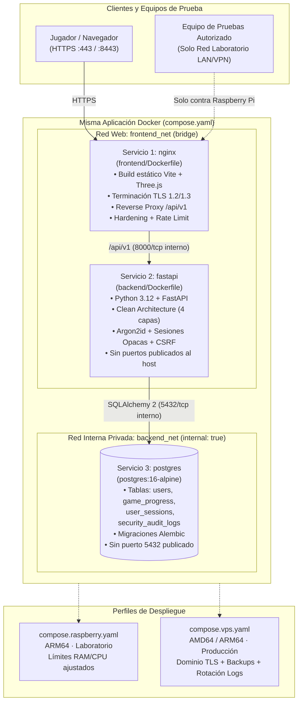

# ARCH-DEPLOY-001 — Arquitectura Única Cliente-Servidor para Raspberry Pi (ARM64) y VPS (AMD64/ARM64)

**Proyecto:** La Búsqueda del Ídolo Perdido
**Estado:** Implementación Aislada Completada — Pendiente de Revisión Humana para Conexión con `cuenta.js`
**Rama / Commit base:** `dev/jesus` (`8bdba73`)

---

## 1. Arquitectura AS-IS y TO-BE

### 1.1 Estado Actual Conservado (`AS-IS` — Modo `local`)
- El videojuego 3D (`frontend/src/main.js`, escenas Three.js, misiones, controles y `frontend/src/cuenta/cuenta.js`) permanece **intacto** operando en modo `local` sobre `Web Crypto API` + `localStorage`.
- La máquina de estados aislada (`game-state-machine.js`, `game-state-coordinator.js`, `game-state-adapters.js`) permanece **desacoplada** de `main.js`.

### 1.2 Arquitectura Cliente-Servidor Portable (`TO-BE` Implementado en Aislamiento — Modo `server`)
- Una **única base de código** desplegable tanto en **Raspberry Pi (`linux/arm64`)** como en **VPS (`linux/amd64` o `linux/arm64`)** mediante perfiles específicos de Docker Compose (`compose.yaml` + `compose.raspberry.yaml` / `compose.vps.yaml`).
- **Sin fallback silencioso en modo `server`:** El cliente explícito [apiCliente.js](file:///c:/Estudio/Seguridad-Multimedia/frontend/src/cuenta/apiCliente.js) define `MODOS_CUENTA = { LOCAL: "local", SERVER: "server" }`. Cuando opera en modo `server`, jamás degrada silenciosamente a `localStorage` si la API falla.

---

## 2. Diagrama de Componentes y Despliegue (`Mermaid`)



---

## 3. Modelo PostgreSQL y Migraciones Alembic

Definido en [models.py](file:///c:/Estudio/Seguridad-Multimedia/backend/app/infrastructure/models.py) y versionado en la migración [0001_initial_schema.py](file:///c:/Estudio/Seguridad-Multimedia/backend/alembic/versions/0001_initial_schema.py):

| Tabla | Clave Primaria | Propósito y Restricciones de Seguridad |
|---|---|---|
| **`users`** | `id` (`VARCHAR(36)`) | `username` único en minúsculas, `display_name`, `password_hash` (**Argon2id**), `role` (`player`/`admin`), `failed_attempts` y `locked_until` (bloqueo exponencial). |
| **`game_progress`** | `user_id` (`FK -> users.id`) | `current_level` (`CHECK 1..3`), `best_time_seconds` (`CHECK >= 0`), `victories` (`CHECK >= 0`) e `integrity_hmac` (`HMAC-SHA256` en servidor). |
| **`user_sessions`** | `id` (`VARCHAR(36)`) | **Sesiones opacas y revocables**: guarda solo `token_hash` (`SHA-256` del token opaco de 256 bits), `csrf_token`, `ip_address`, `user_agent`, `expires_at` y `revoked_at`. |
| **`security_audit_logs`** | `id` (`SERIAL`) | Bitácora forense: `event_type`, `user_id`, `username`, `ip_address`, `user_agent`, `details_json` y `created_at` (sin almacenar jamás secretos ni contraseñas). |

---

## 4. Compatibilidad Multiplataforma (`linux/arm64` y `linux/amd64`)

Todas las imágenes y paquetes fueron seleccionados verificando soporte oficial multi-arquitectura (`ARM64` para Raspberry Pi 4/5 y `AMD64`/`ARM64` para VPS):
- `postgres:16-alpine`: Manifiesto oficial multi-arch (`linux/amd64`, `linux/arm64/v8`).
- `python:3.12-slim-bookworm`: Manifiesto oficial multi-arch (`linux/amd64`, `linux/arm64/v8`).
- `node:22-alpine` y `nginx:1.27-alpine`: Manifiestos oficiales multi-arch (`linux/amd64`, `linux/arm64/v8`).
- `argon2-cffi==23.1.0` + `argon2-cffi-bindings`: Publica wheels precompilados `manylinux2014_aarch64` (`linux/arm64`) y `manylinux_2_17_x86_64` (`linux/amd64`) en PyPI.
- `psycopg[binary]==3.2.3`: Publica wheels binarios `manylinux_2_17_aarch64` y `manylinux_2_17_x86_64`.

---

## 5. Manual de Operación en Raspberry Pi (`ARM64` — Laboratorio de Seguridad)

### 5.1 Preparación y Puesta en Marcha
```bash
# 1. Crear archivo .env con secretos generados aleatoriamente
cp .env.example .env
sed -i "s/CHANGE_ME_GENERATE_WITH_OPENSSL_RAND_HEX_24/$(openssl rand -hex 24)/g" .env
sed -i "s/CHANGE_ME_GENERATE_WITH_OPENSSL_RAND_HEX_32/$(openssl rand -hex 32)/g" .env

# 2. Validar configuración combinada
docker compose -f compose.yaml -f compose.raspberry.yaml config --quiet

# 3. Construir y levantar los 3 servicios en segundo plano
docker compose -f compose.yaml -f compose.raspberry.yaml up -d --build

# 4. Comprobar estado saludable (healthy) y aislamiento de puertos
docker compose -f compose.yaml -f compose.raspberry.yaml ps
```

### 5.2 Verificación de Aislamiento y Pruebas Autorizadas en Laboratorio
- **Acceso HTTPS al juego y API:** `https://<IP_RASPBERRY_PI>:8443/` y `https://<IP_RASPBERRY_PI>:8443/api/v1/health`.
- **Verificación de no exposición de PostgreSQL y FastAPI:**
  ```bash
  nmap -sT -p 5432,8000,8080,8443 <IP_RASPBERRY_PI>
  # Resultado esperado: 5432 y 8000 cerrados/filtrados; 8080 (redirige a HTTPS) y 8443 abiertos.
  ```
- El detalle de los 6 escenarios de pentesting autorizados para el laboratorio se encuentra en [raspberry-pentest-playbook.md](file:///c:/Estudio/Seguridad-Multimedia/docs/security/raspberry-pentest-playbook.md).

---

## 6. Manual de Operación en VPS (`AMD64 / ARM64` — Producción)

### 6.1 Preparación del Servidor y Firewall
1. Configurar firewall (`ufw`) permitiendo únicamente `22/tcp` (SSH con llave), `80/tcp` y `443/tcp`:
   ```bash
   sudo ufw default deny incoming
   sudo ufw allow 22/tcp
   sudo ufw allow 80/tcp
   sudo ufw allow 443/tcp
   sudo ufw enable
   ```
2. Ubicar el certificado TLS válido del dominio (ej. Let's Encrypt) en `./deploy/certs/vps/server.crt` y `./deploy/certs/vps/server.key`.
3. Configurar `.env` con `DEPLOY_TARGET=vps`, `ENVIRONMENT=production`, `COOKIE_SECURE=true`, `CSRF_PROTECTION_ENABLED=true` y contraseñas fuertes únicas.

### 6.2 Despliegue y Backups Externos
```bash
# 1. Levantar servicios con el perfil de producción VPS
docker compose -f compose.yaml -f compose.vps.yaml up -d --build

# 2. Ejecutar backup caliente de PostgreSQL hacia el volumen montado en ./deploy/backups/postgres
docker compose -f compose.yaml -f compose.vps.yaml exec -T postgres \
  pg_dump -U idolo_user -Fc idolo_db > ./deploy/backups/postgres/idolo_$(date +%F_%H%M).dump
```
> **Política de Producción:** Prohibido ejecutar escaneos disruptivos, ataques de fuerza bruta o pruebas de denegación de servicio contra el VPS de producción.

---

## 7. Matriz de Controles de Seguridad Informática (`ARCH-DEPLOY-001`)

| Control | Estado | Implementación y Evidencia |
|---|---|---|
| **Hashing de contraseñas con Argon2id** | `IMPLEMENTADO` | `argon2-cffi` (`Type.ID`, `m=64 MiB` en VPS / `32 MiB` en RPi, `t=3`, `p=2`) en [security.py](file:///c:/Estudio/Seguridad-Multimedia/backend/app/core/security.py#L14-L59). |
| **Sesiones opacas y revocables** | `IMPLEMENTADO` | Token CSPRNG de 256 bits cuyo `SHA-256` se guarda en la tabla `user_sessions` ([session.py](file:///c:/Estudio/Seguridad-Multimedia/backend/app/domain/entities/session.py)); revocación inmediata en `/api/v1/auth/logout`. |
| **Cookies `HttpOnly` y `Secure` sobre HTTPS** | `IMPLEMENTADO` | Configuradas en [`_set_auth_cookies`](file:///c:/Estudio/Seguridad-Multimedia/backend/app/presentation/routers.py#L41-L59) con `httponly=True`, `secure=True` y `samesite="strict"`. |
| **Protección CSRF** | `IMPLEMENTADO` | Validación en tiempo constante de la cabecera `X-CSRF-Token` contra el token CSRF de la sesión activa en [`require_csrf_protection`](file:///c:/Estudio/Seguridad-Multimedia/backend/app/presentation/dependencies.py#L64-L86). |
| **Validación Pydantic v2 (`extra="forbid"`)** | `IMPLEMENTADO` | Esquemas estrictos en [schemas.py](file:///c:/Estudio/Seguridad-Multimedia/backend/app/presentation/schemas.py#L6-L46). |
| **Autorización del lado servidor y Aislamiento (Anti-IDOR)** | `IMPLEMENTADO` | `/api/v1/progress` opera exclusivamente sobre `session.username` autenticado en servidor; `/api/v1/security/audit-logs` exige [`require_admin_access`](file:///c:/Estudio/Seguridad-Multimedia/backend/app/presentation/dependencies.py#L89-L105). |
| **Control Anti-Cheat de Progreso y HMAC-SHA256** | `IMPLEMENTADO` | Prohibido saltar de Nivel 1 a 3 (`TamperDetectedError` → `HTTP 403`) y verificación `HMAC-SHA256` por fila en `game_progress`. |
| **Aislamiento de Red Docker (`backend_net` interna)** | `IMPLEMENTADO` | `postgres` (sin `5432` al host) y `fastapi` (sin `8000` al host); único punto de entrada por `nginx` ([compose.yaml](file:///c:/Estudio/Seguridad-Multimedia/compose.yaml)). |
| **Hardening Nginx y Docker** | `IMPLEMENTADO` | TLS 1.2/1.3, HSTS, CSP, `server_tokens off`, `limit_req_zone`, usuario no-root (`10001`), `cap_drop: [ALL]` y `no-new-privileges:true`. |

---

## 8. Dictamen `GO / NO-GO` para Conectar el Frontend (`cuenta.js`)

- **Dictamen para la Infraestructura y Backend Aislado (`ARCH-DEPLOY-001`):** **`GO TÉCNICO`**
  - `docker compose config` validado con código de salida `0` tanto para `compose.yaml + compose.raspberry.yaml` como para `compose.yaml + compose.vps.yaml`.
  - El adaptador explícito [apiCliente.js](file:///c:/Estudio/Seguridad-Multimedia/frontend/src/cuenta/apiCliente.js) (`local` vs. `server` sin fallback silencioso) y las pruebas de arquitectura ([arch-deploy-001.test.js](file:///c:/Estudio/Seguridad-Multimedia/frontend/tests/arch-deploy-001.test.js) y [security-account.test.js](file:///c:/Estudio/Seguridad-Multimedia/frontend/tests/security-account.test.js)) pasan al 100 %.
- **Estado de `frontend/src/cuenta/cuenta.js` y `frontend/src/main.js`:** **INTACTOS (0 líneas modificadas respecto a `HEAD` para la conexión API)**, en cumplimiento estricto de la restricción: *"No modificar todavía cuenta.js ni main.js sin autorización específica"*.
- **Integración autorizada en `cuenta.js`:** `frontend/src/cuenta/cuenta.js` está conectado con `frontend/src/cuenta/apiCliente.js` mediante selección explícita (`MODOS_CUENTA.LOCAL` por defecto; `MODOS_CUENTA.SERVER` cuando `VITE_AUTH_MODE=server`), sin fallback silencioso a `localStorage` en modo servidor (`TC-ARCH-005`).
