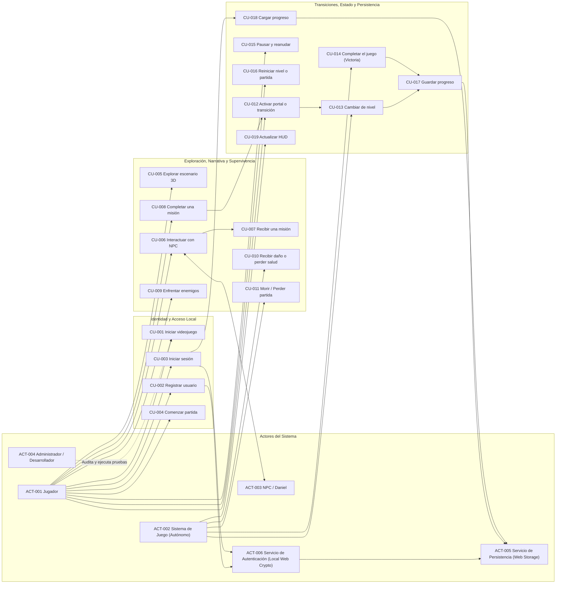
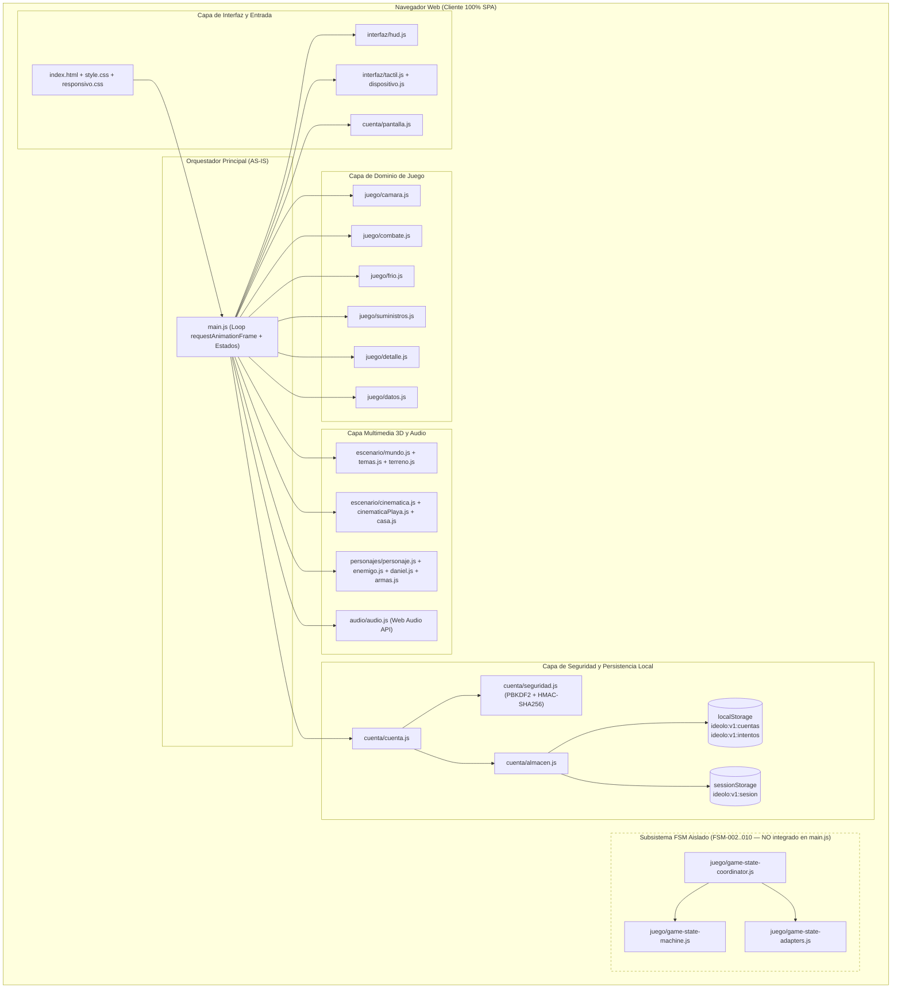
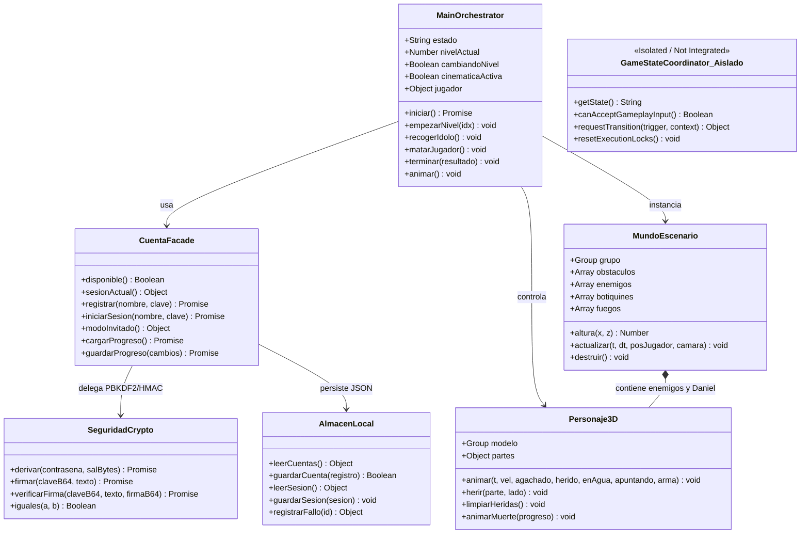
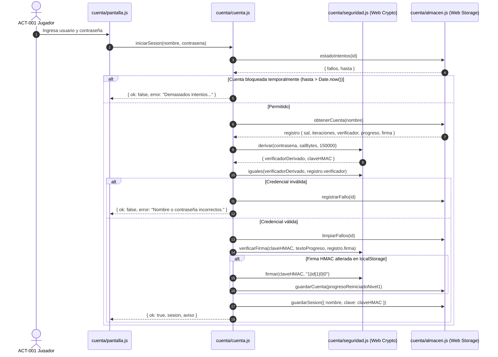
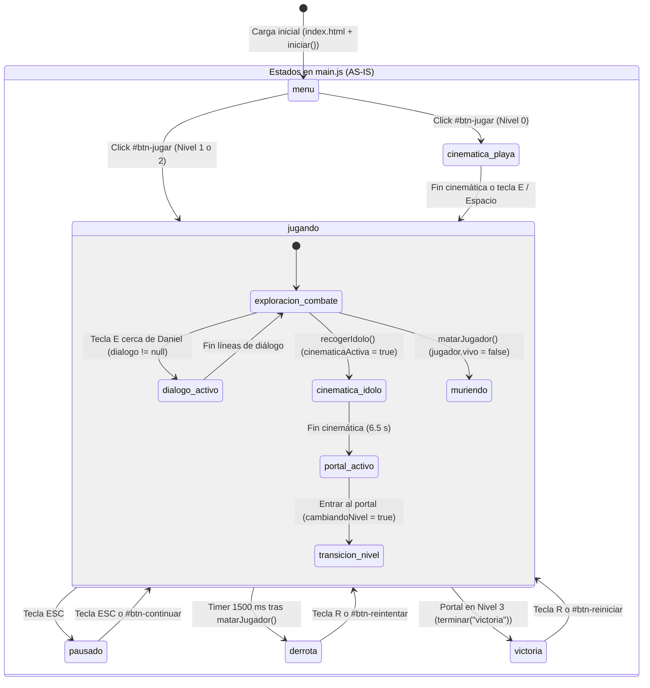
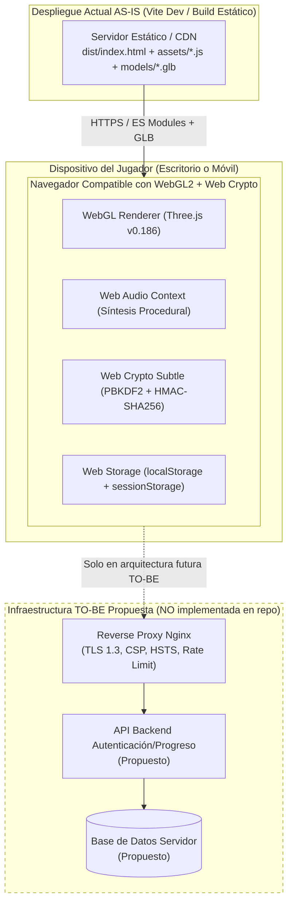
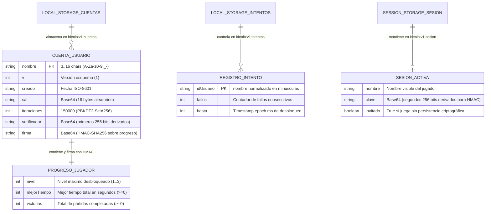

# Arquitectura del Sistema (AS-IS) y Diagramación UML/Mermaid

**Proyecto:** La Búsqueda del Ídolo Perdido
**Versión:** 1.0
**Estado:** Verificado contra código fuente (`dev/jesus` @ `8bdba73`)
**Propósito:** Documentar con fidelidad forense la arquitectura real implementada (*AS-IS*), el inventario clasificado de componentes y los **8 diagramas arquitectónicos obligatorios**.

> **Aviso de vigencia:** Este documento es una instantánea del análisis previo a la incorporación de `backend/` (base `8bdba73`, 2026-11-06); sus secciones sobre cuentas locales y ausencia de backend ya no describen el estado actual. Para la arquitectura cliente-servidor vigente, consultar [arch-deploy-001.md](arch-deploy-001.md).

---

## 1. Resumen Ejecutivo de la Arquitectura AS-IS

**«La Búsqueda del Ídolo Perdido»** es una aplicación web 3D interactiva ejecutada 100 % en el navegador del cliente (*Rich Client SPA / Multi-Entry Vite App*), construida con **JavaScript ES Modules**, **Three.js (`^0.186.1`)**, **WebGL**, **Web Audio API** y **Web Crypto API**.

- **Sin Backend ni Base de Datos Centralizada (`AUSENTE`):** No existe servidor Node/Express/Python ni base de datos SQL/NoSQL. Toda la lógica de simulación, renderizado, audio, autenticación local y persistencia se ejecuta en el navegador del usuario.
- **Coordinación del Ciclo de Vida (`frontend/src/main.js`):** El archivo `main.js` (735 líneas) actúa como orquestador central del bucle `requestAnimationFrame(animar)`, gestionando los estados de ejecución mediante variables mutables (`estado`, `cambiandoNivel`, `cinematicaActiva`, `dialogo`) y delegando la construcción de biomas, personajes, combate, audio e interfaz a módulos especializados.
- **Subsistema FSM Aislado (`PARCIAL / PROPUESTO`):** En `frontend/src/juego/` existen tres módulos (`game-state-machine.js`, `game-state-coordinator.js`, `game-state-adapters.js`) desarrollados en las tareas `FSM-002` a `FSM-010` con 204 pruebas unitarias. Conforme a la restricción operativa del proyecto, **estos módulos permanecen aislados y no están importados en `main.js`**.

---

## 2. Inventario Clasificado del Repositorio (Auditoría Inicial Obligatoria)

Cada componente del sistema ha sido inspeccionado y clasificado como **`IMPLEMENTADO`**, **`PARCIAL`**, **`AUSENTE`**, **`PROPUESTO`** o **`NO APLICABLE`**:

| # | Componente / Subsistema | Clasificación | Evidencia Exacta en Repositorio | Observaciones Técnicas |
|---|---|---|---|---|
| 1 | **Estructura de carpetas** | `IMPLEMENTADO` | `frontend/src/`, `frontend/tests/`, `frontend/public/`, `blender/`, `docs/`, `agents/`, `skills/` | Organización modular por dominios funcionales. |
| 2 | **Tecnologías y versiones** | `IMPLEMENTADO` | `frontend/package.json:1-22` | `three: ^0.186.1`, `vite: ^8.3.5`, `vitest: ^5.1.0`. |
| 3 | **Punto de entrada del frontend** | `IMPLEMENTADO` | `frontend/index.html:127` → `frontend/src/main.js:1-735` | Entradas secundarias de diagnóstico: `visor.html`, `niveles.html`, `pruebas.html`, `rendimiento.html`. |
| 4 | **Backend existente** | `AUSENTE` | Verificado en raíz y `frontend/package.json` | No existe directorio `backend/`, `server/` ni API REST/GraphQL. |
| 5 | **Framework y lenguaje de backend** | `NO APLICABLE` | Sin backend | La arquitectura actual es 100 % *client-side*. |
| 6 | **Base de datos de servidor** | `AUSENTE` | Sin motor SQL/NoSQL | Persistencia delegada al navegador (`Web Storage API`). |
| 7 | **Sistema real de autenticación** | `IMPLEMENTADO` (Local) | `frontend/src/cuenta/cuenta.js:1-244`, `seguridad.js:1-151`, `pantalla.js:1-232` | Registro/login local con `PBKDF2-SHA256` (150k iteraciones), comparación en tiempo constante y bloqueo exponencial local. |
| 8 | **Persistencia de usuarios y partidas** | `IMPLEMENTADO` (Local) | `frontend/src/cuenta/almacen.js:1-147` | `localStorage` (`ideolo:v1:cuentas`, `ideolo:v1:intentos`, `calidad`) y `sessionStorage` (`ideolo:v1:sesion`) firmados con `HMAC-SHA256`. |
| 9 | **Motor de renderizado** | `IMPLEMENTADO` | `frontend/src/main.js:18-48`, `juego/detalle.js:1-51` | `THREE.WebGLRenderer` con `ACESFilmicToneMapping`, sombras `PCFSoftShadowMap` y 3 niveles de calidad (`bajo`, `medio`, `alto`). |
| 10 | **Sistema de físicas y colisiones** | `IMPLEMENTADO` | `main.js:500-526`, `escenario/utilidades.js:4-25`, `escenario/terreno.js:3-19`, `juego/combate.js:13-86` | Cinemática custom en 2.5D: altura analítica `alturaTerreno(x,z,tema)`, gravedad (`28 u/s²`), colisión círculo-círculo (`empujarFuera`) y hitboxes anatómicos (`zonaDeBala`). |
| 11 | **Recursos 3D y formatos** | `IMPLEMENTADO` | `frontend/public/models/daniel.glb`, `idolo.glb` (`max.glb` y `enemigo.glb` presentes pero no referenciados) | `main.js:188-189` carga `daniel.glb` (reutilizado y personalizado para Max, Daniel y enemigos) e `idolo.glb`. Escenario 100 % procedural. |
| 12 | **Controladores de cámara** | `IMPLEMENTADO` | `frontend/src/juego/camara.js:1-92`, `escenario/cinematicaPlaya.js`, `escenario/cinematica.js`, `escenario/casa.js` | Cámara en 3.ª persona con seguimiento exponencial, anticolisión con terreno/obstáculos y modos cinemáticos (playa, altar, casa, muerte). |
| 13 | **Gestión de sonido** | `IMPLEMENTADO` | `frontend/src/audio/audio.js:1-383` | Sintetizador procedural Web Audio API (música por bioma, viento, oleaje, pasos, disparos, alertas, victoria y derrota). |
| 14 | **Sistema de misiones** | `IMPLEMENTADO` | `frontend/src/juego/datos.js:23-61`, `main.js:559-627`, `interfaz/hud.js:47-62` | Objetivos por nivel con verificación de prerrequisitos (`requisitosListos`), diálogo con Daniel y checklist dinámico en HUD. |
| 15 | **Gestión de niveles** | `IMPLEMENTADO` | `frontend/src/escenario/temas.js:3-98`, `mundo.js:19-160`, `main.js:234-275`, `main.js:337-352` | 3 niveles jugables (`Selva Tropical`, `Montaña Nevada`, `Desierto`) + escena final de victoria (`casa.js`). |
| 16 | **FSM y coordinador de estados** | `PARCIAL` / `PROPUESTO` | `frontend/src/juego/game-state-machine.js`, `game-state-coordinator.js`, `game-state-adapters.js` | Implementados y probados en aislamiento (204 tests), pero **no integrados en `main.js`** (`ADR-001` y `ADR-002` en estado `Propuesto`). |
| 17 | **Pruebas automatizadas** | `IMPLEMENTADO` | `frontend/tests/*.test.js` (8 suites, 215 tests en Vitest) + `frontend/src/herramientas/pruebas.js` (40+ aserciones en navegador) | Cobertura de FSM, criptografía, cuentas, misiones, combate, frío y terreno. |
| 18 | **Configuración dev / prod** | `IMPLEMENTADO` | `frontend/package.json:6-11`, `dist/` | Scripts `dev`, `build`, `preview`, `test`, `test:watch` operativos con Vite 8 y Vitest 5. |
| 19 | **Documentación de ingeniería** | `IMPLEMENTADO` | `docs/requirements/`, `docs/architecture/`, `docs/security/`, `docs/quality/`, `docs/engineering/` | Conjunto documental completo alineado con el código real. |

---

## 3. Arquitectura en Capas (AS-IS vs. TO-BE)

### 3.1 Modelo en Capas AS-IS (Implementación Real)
1. **Capa de Presentación e Interfaz (`frontend/index.html`, `interfaz/`, `cuenta/pantalla.js`):**
   - Superposiciones DOM (`#inicio`, `#hud`, `#dialogo`, `#pausa`, `#derrota`, `#victoria`, `#cortina`, `.cuenta-capa`), controles táctiles (`tactil.js`) y estilos responsivos (`style.css`, `responsivo.css`).
2. **Capa de Orquestación y Bucle de Simulación (`frontend/src/main.js`):**
   - Inicializa `THREE.WebGLRenderer`, captura entradas de teclado/ratón/toque, ejecuta el bucle `animar()` y coordina directamente transiciones de nivel, combate, diálogos y llamadas a `cuenta.guardarProgreso()`.
3. **Capa de Dominio de Juego y Reglas (`frontend/src/juego/`):**
   - Reglas de combate (`combate.js`), cámara (`camara.js`), frío ambiental (`frio.js`), recolección de suministros (`suministros.js`), calidad gráfica (`detalle.js`) y catálogo de niveles/armas (`datos.js`).
   - *Módulos aislados pre-integración:* `game-state-machine.js`, `game-state-coordinator.js`, `game-state-adapters.js`.
4. **Capa de Entidades 3D, Escenarios y Multimedia (`frontend/src/escenario/`, `personajes/`, `audio/`):**
   - Generación procedural de mundos (`mundo.js`, `terreno.js`, `agua.js`, `vegetacion.js`, `cielo.js`, `nieve.js`, `portal.js`, `botiquines.js`, `casa.js`), cinemáticas (`cinematica.js`, `cinematicaPlaya.js`), articulación de personajes (`personaje.js`, `enemigo.js`, `daniel.js`, `armas.js`, `poses.js`) y síntesis Web Audio (`audio.js`).
5. **Capa de Seguridad Local y Persistencia (`frontend/src/cuenta/`):**
   - Fachada de sesión y autorización local (`cuenta.js`), primitivas criptográficas `PBKDF2-SHA256` y `HMAC-SHA256` (`seguridad.js`) y adaptador de almacenamiento validado (`almacen.js` sobre `localStorage` y `sessionStorage`).

---

## 4. Los 8 Diagramas Arquitectónicos Obligatorios (Mermaid)

### 4.1 Diagrama de Casos de Uso (`ACT-001` a `ACT-006` y `CU-001` a `CU-019`)



---

### 4.2 Diagrama de Componentes (Arquitectura Real AS-IS vs. Componentes Aislados/Propuestos)



---

### 4.3 Diagrama de Clases y Módulos Principales



---

### 4.4 Diagrama de Secuencia — Registro, Inicio de Sesión y Carga Segura de Progreso (`CU-002`, `CU-003`, `CU-018`)



---

### 4.5 Diagrama de Secuencia — Daño Mortal, Colisión de Transición y Derrota (`CU-010`, `CU-011`, `POL-FSM-001`)

```mermaid
sequenceDiagram
    autonumber
    participant Loop as main.js (animar)
    participant E as personajes/enemigo.js
    participant Armas as personajes/armas.js
    participant Timer as setTimeout (1500 ms)
    participant HUD as interfaz/hud.js

    Loop->>E: actualizarEnemigos(enemigos, mundo, jugador, dt, t)
    E->>E: actualizarBalas(mundo, jugador, dt)
    E->>Armas: zonaDeBala(alturaRelativa, lateral)
    Armas-->>E: { zona: "el pecho", dano: 100, mortal: true }
    E->>Loop: callback golpeJugador(impacto)
    Loop->>Loop: jugador.vida = 0; matarJugador()
    Note over Loop,Timer: Riesgo AS-IS [MM-P0-02]: Si cambiandoNivel==true o dialogo!=null,<br/>el enemigo sigue disparando y matarJugador() agenda derrota diferida.
    Loop->>Loop: jugador.vivo = false; jugador.tiempoMuerte = 0.001
    Loop->>Timer: setTimeout(() => terminar("derrota"), 1500)
    Timer->>Loop: terminar("derrota") (si estado === "jugando")
    Loop->>HUD: mostrarDerrota(causaMuerte)
```

---

### 4.6 Diagrama de Estados — Ciclo de Vida en `main.js` (AS-IS) vs. FSM Formal (`FSM-002..010`)



---

### 4.7 Diagrama de Despliegue (AS-IS Estático vs. TO-BE Opcional con Servidor Endurecido)



---

### 4.8 Diagrama de Datos y Persistencia Local (`Web Storage API`)


